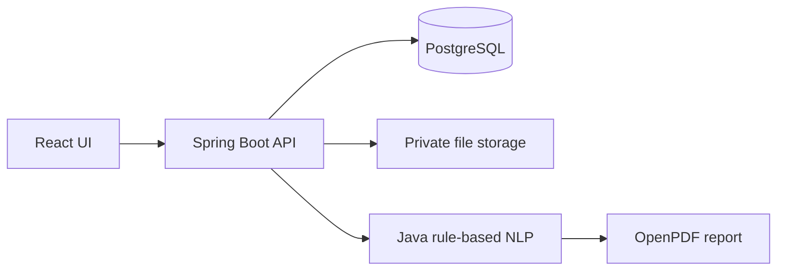

# LexiScan — AI-Powered Legal Document Analyzer

LexiScan is a Java 17/Spring Boot and React application that turns PDF or DOCX contracts into a plain-language summary, key details, clause list, risk flags, score, and PDF report. **This tool assists understanding and is not legal advice.**

## Run

1. Copy `.env.example` to `.env` and replace `POSTGRES_PASSWORD` and `JWT_SECRET` with strong values. Set `ADMIN_EMAIL` and a 12+ character `ADMIN_PASSWORD` only if an initial admin account is wanted.
2. `docker compose up --build -d`
3. Open `http://localhost:5173` for the frontend; API docs & Swagger UI are at `http://localhost:8081/swagger-ui.html`.

The current environment has Docker installed but its daemon was not running during validation. Maven is also absent locally; Docker builds the Maven project in a container.

## Architecture

## NLP and scoring

The default engine normalizes extracted PDF/DOCX text, segments numbered/heading clauses, classifies each clause using a weighted keyword dictionary, extracts dates/amounts/durations/parties with patterns, and applies active database rules plus contextual high-risk patterns. Clause scores are 0–100; LOW is below 35, MEDIUM 35–69, and HIGH 70+. The document score is the capped arithmetic mean of clause scores: `min(100, round(sum(clause scores) / clause count))`.

## API

`POST /api/auth/register`, `POST /api/auth/login`, `GET /api/auth/me`; document upload/list/get/delete/analyze at `/api/documents`; analysis, clauses and report below `/api/documents/{id}`; administrator operations at `/api/admin/users`, `/api/admin/stats`, and `/api/admin/rules`.

## Security and limitations

JWT sessions are stateless, passwords use BCrypt, file magic bytes and size are checked, stored file names are generated UUIDs, and service-layer ownership checks return 404 for another user’s document. The seeded rules are a heuristic starting point; results depend on text quality and jurisdiction. Scanned PDFs need OCR (not bundled). Planned improvements include regional languages, OCR, comparisons, safer clause suggestions, contract chat, and lawyer review workflows.
